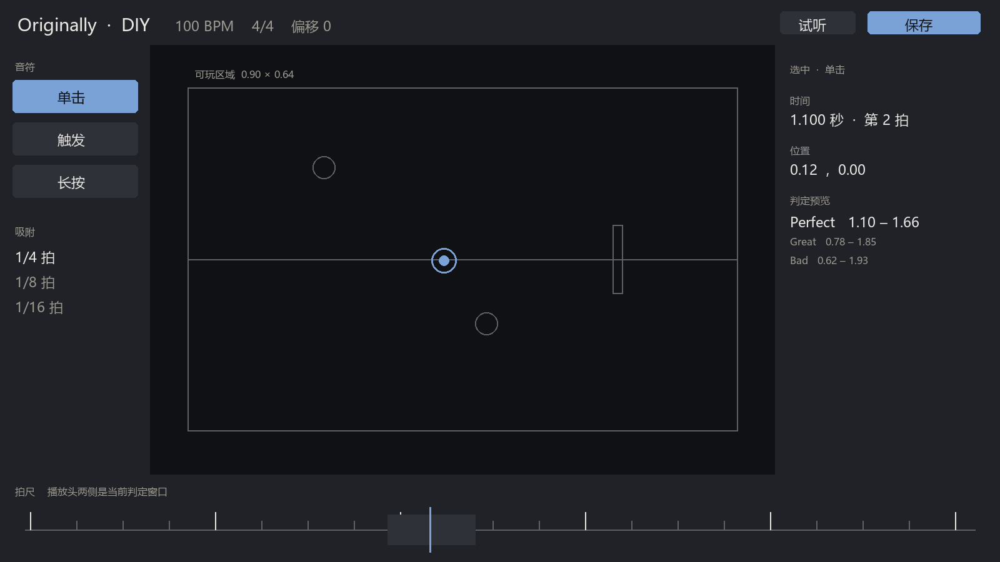

# DIY 场景与音符触发

这份文档只定场景和触发方式，不改现有对局。DIY 画面以正式舞台为中心，工具贴在四周。音符触发沿用现在的单击、触发、长按，但生成、点选和音效需要先收干净，否则做谱试听会对不上正式游玩。

## 场景

舞台约占画面 65%，背景、判定线和音符预制体直接用 Game 里的那一套。可玩范围用现在的 0.90 × 0.64 画一条细框，框外点下去不落音符。已经放下的音符以较低透明度留在舞台上，只有选中的那一颗用强调色圈出来。

| 区域 | 占位 | 上面有什么 |
|---|---|---|
| 顶栏 | 约 72 高 | 曲名、BPM、拍号、偏移、试听、保存 |
| 左栏 | 约 240 宽 | 单击、触发、长按，以及 1/4、1/8、1/16 吸附 |
| 舞台 | 剩余中央 | 同一张背景、同一条判定线、幽灵音符和可玩框 |
| 右栏 | 约 360 宽 | 没选中时几乎是空的；选中后显示时间、位置和判定预览 |
| 拍尺 | 约 140 高 | 小节刻度、播放头，两侧叠着当前判定窗口 |

网格和框保持细线。舞台上的强调色只给播放头和选中音符，避免编辑器看起来像另一套游戏。

### 落音符

播放头停在吸附后的拍点上，在可玩框里点一下。时间用播放头的 SongTime，位置按舞台坐标换算成长按和单击现在用的屏幕比例。长按再拖一截，长度收成现有的 0.5、1、2、4 小节。界面上看到的是拍数和坐标，保存时再编回原来的整数 payload，写成 `ChartDocument`。

试听走同一条 `ChartPlayback`，到点才生成。这时左右栏退下去，舞台回到对局构图；停下来，工具再回到原位，播放头停在那一拍。

### 场景层级

- `Stage` 放背景、判定线和音符，复用 Game 的预制体。
- `EditorChrome` 是单独的屏幕画布，盖在舞台上面，不和音符排在同一个排序层。
- `Conductor` 只挂一条音源。编辑时暂停，试听时播放。

第一版只做音符轨。判定线运动、区域和背景切换收在「舞台动画」里，不和落音符放在同一屏。

判定预览用现在的窗口，单位是 100 BPM、1 拍下的基准秒，游玩时仍除以 `speedFec`：

| 档位 | 范围 |
|---|---|
| Bad | 0.62 – 1.932 |
| Great | 0.78 – 1.852 |
| Perfect | 1.10 – 1.66 |

判定点仍是 1.10 秒。触发音符跟着 Perfect 这一段。长按从 1.10 秒起按，读条比例仍是 85% 和 70%。

## 音符触发要先收的地方

现在的正式对局里，音符生成、点中和出声是三条分开的路径，而且测试代码还留在判定里。DIY 试听如果直接接上，谱面会被自动打完，音效也会和玩家的点击叠在一起。

### 生成和查找

每颗音符都是 `Instantiate`，结束时 `Destroy`。判定特效再单独 `Instantiate` 一次。密谱时分配和销毁会堆在同一拍上。

每颗音符在 `Awake` 或 `Start` 里用名字找 `InfoManager`、`ResultManager`、`EffectController`。单击和触发命中时再找一次 `MusicManager`，拿它的 `AudioSource` 播 `PlayOneShot`。`TouchController` 在有触摸的帧里对整个音符面板做 `GetComponentsInChildren<Spot>()`，再建一张可点列表，循环里反复取碰撞体。`Camera.main` 也在每根手指上取一次。

这些查找和实例化可以收成进入对局时备好的引用，音符和特效从池里取。点选只遍历当前可点的那一小列，不要每帧扫全部子物体。

### 音效

单击和触发把打击声打在歌曲那条音源上。歌曲暂停、音量变化和结算换曲都会带上打击声。长按的 `PlaySound` 是空的，Perfect 和 Great 都不会出声。

更直接的问题是测试用的自动命中还开着。`SingleSpotNew` 在 Perfect 开始后 0.1 秒自己调用 `DoTouch`，`TouchSpotNew` 同样自己调用 `DoTouch`，`PressSpotNew` 会自己按下再松开。`DoTouch` 没有「已经判定过」的锁，玩家如果先点中，自动分支仍会再进一次，分数和音效各算两遍。

打击声应该单独一条音源，只在玩家判定成功时播一次。长按补上和单击同一套的成功音。自动命中从正式路径和 DIY 试听里拿掉，需要自动演奏时另开一个开关。

### 点中方式

`TouchController` 只读 `Input.touchCount`。编辑器里用鼠标玩、以及 DIY 试听时的鼠标，都进不了这条路径，所以现在能「打中」主要靠上面的自动调用。

松手检测写在 `touchCount > 0` 里面。最后一根手指抬起时触摸数为 0，这一帧不会调用 `DoRelease`，长按要靠自动松开才结束。

碰撞用 `ClosestPoint` 再要求距离不超过 0.02。这个阈值比音符本身小得多，手指稍偏就不会绑定。可点列表按生成倒序取第一颗碰到的音符，重叠时没有按时间或距离再选一次。

点中应同时接受触摸和鼠标。手指抬起、触摸数变成 0 时仍要检查正在按住的长按。判定成功后立刻锁住这颗音符，重复进入 `DoTouch` 或 `DoPress` 直接返回。命中范围用音符碰撞体本身，不再加 0.02 的第二道距离。

### 命中反馈

`EffectController` 用 `new Color(255, 255, 130, 1)` 这种写法上色。Unity 的 `Color` 分量是 0 到 1，超过 1 会被夹成 1，Perfect 和 Great 的颜色都会变成白色。Bad 和 Miss 没有单独的颜色分支，只换了等级图。

反馈颜色改成 0 到 1 的分量，和等级图一起由判定结果驱动。特效物体同样进池，不要每次命中新建一个。
